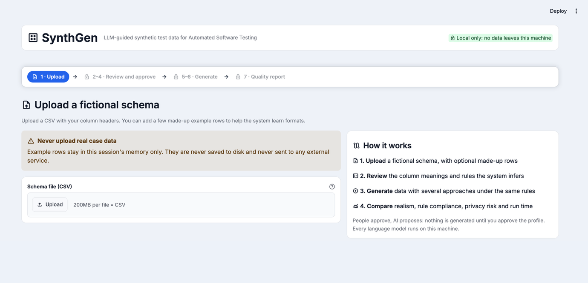
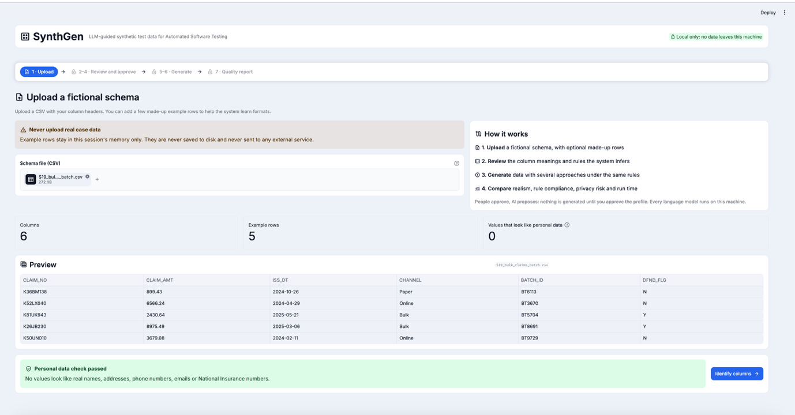
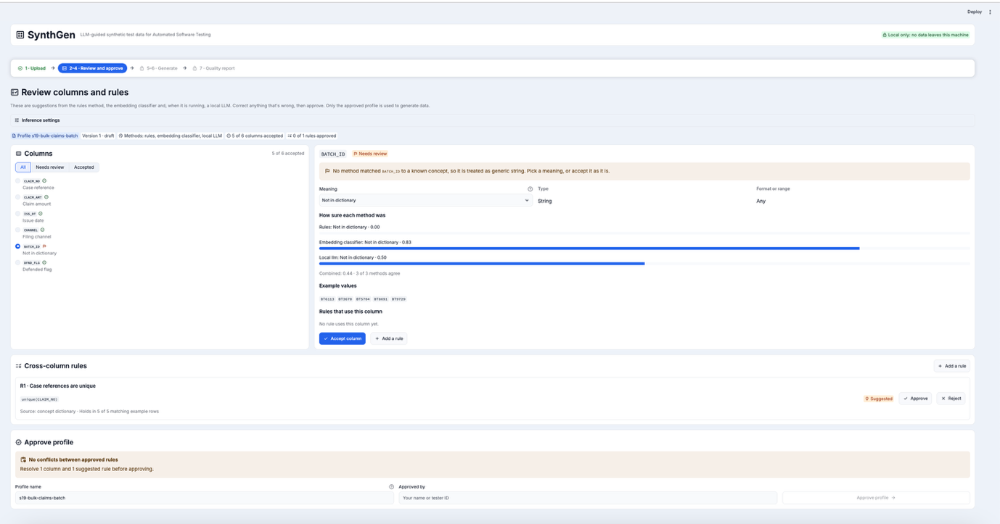
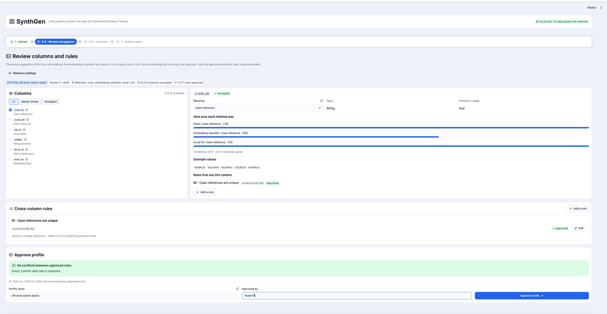
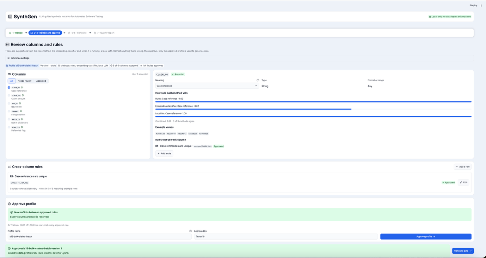
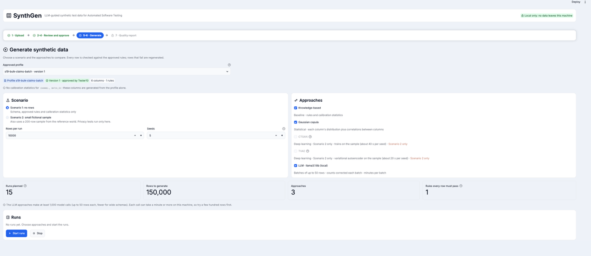
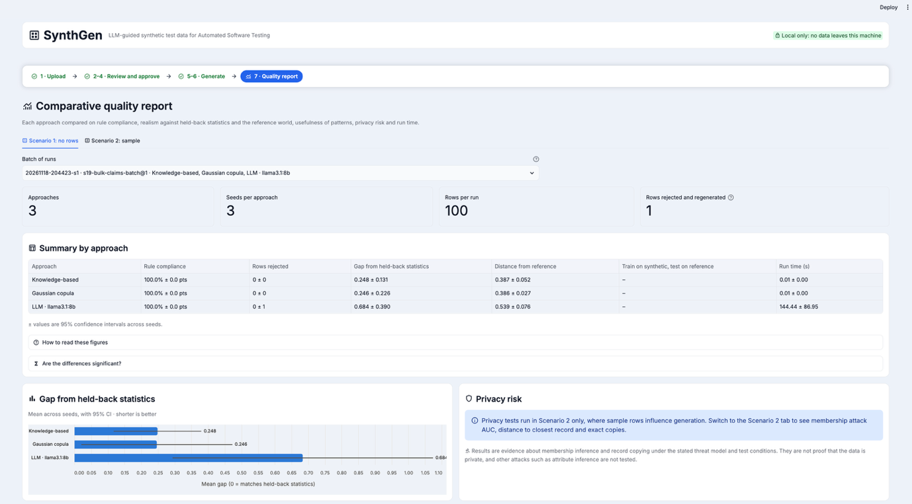
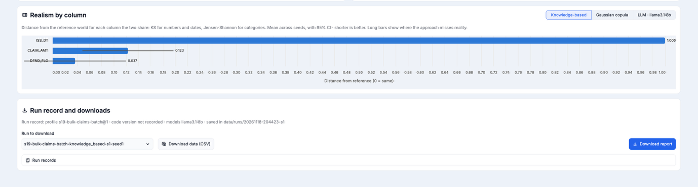

# SynthGen

*LLM-guided synthetic test data for automated software testing: application screenshots*

## 1. Overview

AI proposes and people approve: nothing is generated until a person signs off the schema profile. A Streamlit app takes the user through seven steps, grouped in the app into four stages: Upload (step 1), Review and approve (steps 2–4), Generate (steps 5–6) and Quality report (step 7). The screenshots below follow the same order.

## 2. Application walkthrough

### 2.1 Step 1: Upload and screen the schema

The user uploads a fictional CSV schema, and the app screens it for anything that looks like personal data.

*Figure 1: Upload screen for a fictional CSV schema*

*Figure 2: Schema preview with the personal data screen passed*

### 2.2 Step 2: Infer column meanings

The app infers each column's meaning with three methods (rules, an embedding classifier and a local LLM), combined by a weighted vote.

*Figure 3: Column meanings inferred by the three methods*

### 2.3 Step 3: Propose business rules

The app proposes business rules across columns, such as “hearing date is after issue date”.

*Figure 4: Proposed cross-column business rules*

### 2.4 Step 4: Review, correct and approve the profile

The user reviews and corrects the inferred meanings and rules, then approves the schema profile. Nothing is generated before this sign-off.

*Figure 5: Approved schema profile*

### 2.5 Steps 5–6: Generate and validate data

The app generates data with several approaches under the same rules. It validates every row, then rejects and regenerates any rows that fail.

*Figure 6: Data generation with several approaches under the same rules*

### 2.6 Step 7: Compare the approaches

A quality report compares the approaches side by side.

*Figure 7: Comparative quality report: summary by approach*

*Figure 8: Quality report: realism by column, run record and downloads*

## 3. Privacy and local processing

All language models run locally through Ollama, behind a gateway that refuses any address other than this machine.
